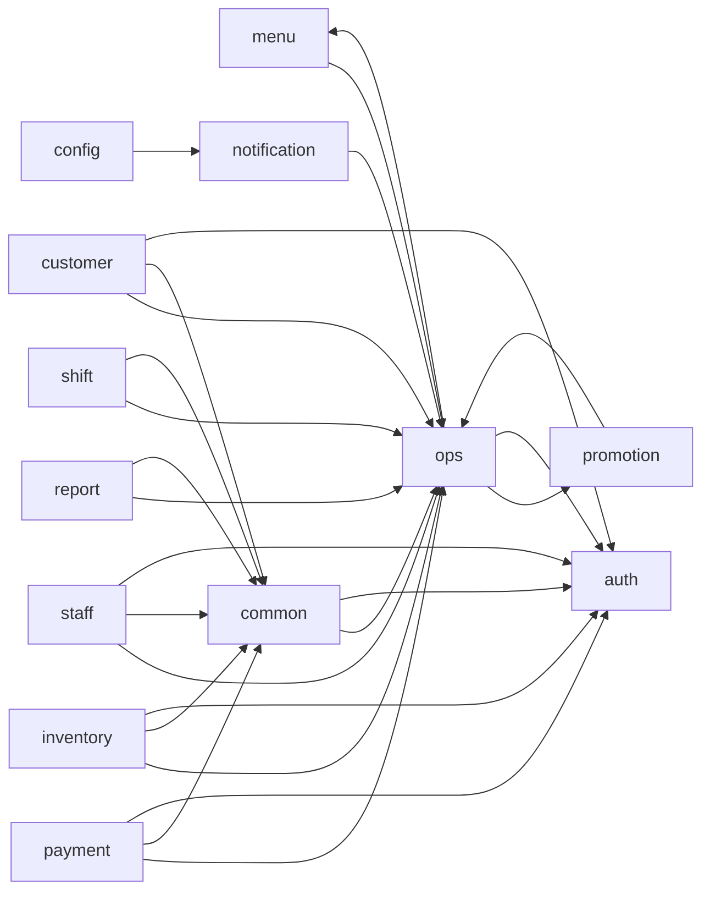

# Tài liệu refactor backend

Gộp từ 5 tệp trong `docs/refactor/` (khảo sát ngày 2026-10-26). Quy ước: **[Đã xác minh]** = đọc trực tiếp từ mã/lược đồ/chạy thử; **[Giả thuyết]** = suy luận, chưa kiểm chứng.

## Mục lục

1. Kiến trúc hiện tại của backend
2. Cơ sở dữ liệu MySQL hiện tại
3. Bản đồ phụ thuộc giữa các gói
4. Nợ kỹ thuật và rủi ro
5. Nhật ký refactor backend

---

## Phần 1. Kiến trúc hiện tại của backend (khảo sát, chưa thay đổi gì)

Ngày khảo sát: 2026-10-26. Phạm vi: `backend/` (Java), đối chiếu với `database/` và `frontend/` khi cần.
Quy ước: **[Đã xác minh]** = đọc trực tiếp từ mã/lược đồ/chạy thử; **[Giả thuyết]** = suy luận, chưa kiểm chứng.

### 1. Công nghệ [Đã xác minh]

| Hạng mục | Giá trị |
|---|---|
| Java / build | Java 21, Maven, `spring-boot-starter-parent` 3.3.5 |
| Web | Spring MVC (`spring-boot-starter-web`), Spring Security (phiên bằng cookie `VTPHSESSION`), WebSocket/STOMP, Actuator, springdoc-openapi 2.6.0 |
| Truy cập dữ liệu | `spring-boot-starter-jdbc` (JdbcTemplate). **Không** dùng JPA/Hibernate hay MyBatis |
| CSDL | MySQL 8.4; Flyway (`flyway-core`, `flyway-mysql`) |
| Kiểm thử | JUnit 5, Spring Boot Test, Testcontainers MySQL 8.4 |
| Quy mô mã | 4.372 dòng Java trong `src/main` tại thời điểm khảo sát (55 tệp, trong đó 44 tệp mã và 11 `package-info`); sau bước 1 thêm gói `shared` |
| Số điểm cuối REST | khoảng 86 ánh xạ (`@Get/Post/Put/...Mapping`) trong 12 controller |

Không có công cụ phân tích tĩnh/định dạng (Checkstyle, Spotless, SpotBugs, Sonar...) trong `pom.xml` [Đã xác minh].

### 2. Cấu trúc gói (`vn.vtph.coffee`)

Kiểu tổ chức: **package-by-feature**, một ứng dụng đơn khối (modular monolith). Mỗi gói thường chứa Controller + Service (+ vài lớp phụ) cùng nhau; không có tầng domain riêng.

| Gói | Vai trò | Lớp chính (dòng) |
|---|---|---|
| `ops` | Bàn, đơn tại quán, đơn mang đi, bếp, ca thu ngân, thanh toán, đơn nháp | `JdbcOpsService` (955), `InMemoryOpsService` (418), `OpsController` (80), `OpsService`, `Model`, `OpsException` |
| `payment` | Hóa đơn: danh sách, hủy, hủy dòng món đơn mang đi, hoàn tiền | `InvoiceService` (246), `InvoiceController` |
| `inventory` | Nguyên liệu, công thức, nhập kho, kiểm kê, hao hụt, cảnh báo | `InventoryService` (256), `InventoryController` |
| `menu` | Món, topping, ảnh món | `MenuAdminService` (216), `MenuAdminController`, `MenuImageStore`, `MenuImageController` |
| `staff` | Nhân viên/tài khoản, chấm công | `StaffService`, `AttendanceService`, 2 controller |
| `auth` | Đăng nhập, khóa tài khoản, kho tài khoản | `AuthService`, `AuthController`, `AccountStore` + `JdbcAccountStore`/`InMemoryAccountStore` |
| `customer` | Thành viên, điểm | `CustomerService`, `CustomerController` |
| `promotion` | Khuyến mãi | `PromotionService`, `PromotionController` |
| `report` | Báo cáo doanh thu | `ReportService`, `ReportController` |
| `shift` | Chốt ngày kinh doanh | `DayService`, `DayController` |
| `notification` | Cầu nối sự kiện → STOMP | `NotificationBridge` |
| `config` | Security, WebSocket | `SecurityConfig`, `WebSocketConfig` |
| `shared` | (mới, bước 1 refactor) `shared.pricing.PricingPolicy`: quy tắc tính tiền/điểm thuần Java |
| `common` | Truy cập DB, kiểm tra quyền, xử lý lỗi | `Db`, `Access`, `ApiExceptionAdvice`, `GlobalExceptionHandler` |
| `web` | Health | `HealthController` |
| `table`, `kitchen`, `takeaway` | **Chỉ có `package-info.java`** (mô tả), không có mã; mã tương ứng nằm trong `ops` |

### 3. Hai chế độ chạy (profile) [Đã xác minh]

- **`mysql`** (đầy đủ chức năng): mọi service/controller ở trên đều gắn `@Profile("mysql")`.
- **mặc định (không có CSDL)**: chỉ còn `InMemoryOpsService` + `InMemoryAccountStore` (dữ liệu giả); các module quản trị, thanh toán hóa đơn, kho, báo cáo, chốt ngày **không tồn tại**. `OpsService` là giao diện có hai cài đặt (`JdbcOpsService`, `InMemoryOpsService`).
- Dữ liệu mẫu nằm ở thư mục `db/seed` và nạp cùng `db/migration` qua cấu hình `spring.flyway.locations` (mặc định nạp cả hai).

### 4. Luồng xử lý điển hình [Đã xác minh]

`HTTP → Controller (kiểm tra phiên/vai trò bằng Access.who) → Service (@Transactional, SQL bằng JdbcTemplate/Db) → MySQL (ràng buộc + trigger)`.
Sự kiện vận hành: service gọi `ApplicationEventPublisher.publishEvent(OpsEvent)` → `NotificationBridge` (`@TransactionalEventListener(fallbackExecution = true)`) → `SimpMessagingTemplate` gửi tới `/topic/kitchen|service|cashier`.

Quy tắc nghiệp vụ nằm **ở ba nơi**: Java service (phần lớn), trigger/ràng buộc MySQL (ví dụ chặn UPDATE hóa đơn, một đơn mở mỗi bàn, một ca mở), và procedure `sp_start_making`.

### 5. Bảo mật và cấu hình [Đã xác minh]

- Spring Security: mọi `/api/**`, `/ws/**`, `/actuator/**` cần đăng nhập, ngoại trừ `/api/auth/**`, `/api/health`, `/actuator/health|info`, và **Swagger/OpenAPI (`/v3/api-docs/**`, `/swagger-ui/**`) luôn mở công khai**.
- CSRF tắt (ADR-004: cookie `SameSite=Lax` + CORS theo danh sách nguồn); cookie `HttpOnly`; đổi mã phiên sau đăng nhập (`changeSessionId`).
- Phân quyền theo vai trò thực hiện **thủ công trong controller** (`who(session, Role...)`) và một phần trong service (ví dụ hủy món đang pha: so `Account.role`). Chủ quán kế thừa mọi quyền (`Access.who`).
- bcrypt (độ khó 10) cho PIN và mật khẩu; cờ `vtph.auth.legacy-demo-hash` chấp nhận băm SHA-256 của dữ liệu mẫu rồi nâng cấp lên bcrypt.
- Mật khẩu CSDL lấy từ biến môi trường `DB_PASSWORD` (mặc định rỗng). Không có cấu hình pool riêng (dùng mặc định HikariCP).
- Tải ảnh: `vtph.uploads.dir` (mặc định thư mục tương đối `uploads`), giới hạn multipart 6 MB, loại JPG/PNG/WebP.

### 6. Xử lý lỗi [Đã xác minh]

Bốn nơi xử lý ngoại lệ song song: `ApiExceptionAdvice` (`HIGHEST_PRECEDENCE`), `GlobalExceptionHandler`, `OpsController.onOps`, `AuthController.onAuth`. Cùng khuôn trả về `{code, message, ...}` nhưng khai báo ở nhiều chỗ.

### 7. Kiểm thử [Đã xác minh]

50 test: 3 lớp tích hợp trên MySQL thật (Testcontainers: `MySqlAuthIntegrationTest`, `MySqlAdminIntegrationTest`, `MySqlOpsIntegrationTest`) + 4 lớp chạy không cần CSDL (`AuthServiceTest`, `AccessAndRealtimeTest`, `NotificationBridgeTest`, `NotificationAfterCommitTest`). Chạy lần cuối: `Tests run: 50, Failures: 0`. Không có kiểm thử hợp đồng API riêng, không có kiểm thử đơn vị cho tính toán giá/điểm (chỉ được kiểm qua tích hợp).

### 8. Điều chưa xác minh

- Chưa có dữ liệu tải thật; số đo hiệu năng chỉ trên dữ liệu mẫu nhỏ (xem phần 4, mục Hiệu năng).
- Chưa kiểm tra các hệ thống tích hợp ngoài: mã không có email/thanh toán/lưu trữ bên thứ ba [Đã xác minh: không thấy dependency tương ứng].

---

## Phần 2. Cơ sở dữ liệu MySQL hiện tại (khảo sát, chưa thay đổi gì)

Nguồn: `database/01_schema.sql`, `02_triggers.sql`, `04_views_procedures.sql` (nguồn chuẩn), bản sao Flyway ở `backend/src/main/resources/db/` (sinh bằng `scripts/sync-migrations.py`). Ngày 2026-10-26.
**[Đã xác minh]** = đọc từ tệp SQL; **[Giả thuyết]** = chưa chạy `EXPLAIN` hay đo tải thật.

### 1. Tổng quan [Đã xác minh]

- MySQL 8.4, InnoDB, utf8mb4. 28 bảng, 42 khóa ngoại, 38 ràng buộc `CHECK`, 29 khóa/chỉ mục khai báo trong `CREATE TABLE`.
- 15 trigger, 5 view, 1 stored procedure (`sp_start_making`).
- Flyway: `V1__schema`, `V2__triggers`, `V4__views_procedures` ở `db/migration`; `V3__seed_master`, `V5__seed_transactions` ở `db/seed`. Cấu hình `spring.flyway.locations` nạp cả hai thư mục (nên dữ liệu mẫu chen giữa V2 và V4). Triển khai thật phải đặt `FLYWAY_LOCATIONS=classpath:db/migration`.
- `validate-on-migrate=true`: sửa nội dung tệp migration đã áp dụng làm Flyway báo lệch checksum (đã gặp khi đổi dữ liệu mẫu).

### 2. Nhóm bảng

| Nhóm | Bảng |
|---|---|
| Nhân sự | `employee`, `account`, `attendance`, `attendance_edit` |
| Ca và ngày | `business_day`, `cashier_session` |
| Thực đơn | `menu_item`, `item_size`, `topping`, `menu_item_topping`, `promotion` |
| Kho | `ingredient`, `recipe`, `recipe_line`, `stock_receipt`, `stock_adjustment`, `waste_record` |
| Khách hàng | `customer`, `point_transaction` |
| Đơn hàng | `dining_table`, `orders`, `dine_in_order`, `takeaway_order`, `order_batch`, `order_line`, `order_line_topping` |
| Thanh toán | `invoice`, `refund_record` |

### 3. Quy tắc nghiệp vụ đặt ngay trong CSDL [Đã xác minh]

| Cơ chế | Mục đích |
|---|---|
| `uq_one_open_session (open_flag)` | Tại mỗi thời điểm chỉ một phiên ca mở |
| `uq_one_open_order_per_table (open_table_id)` | Mỗi bàn tối đa một đơn mở |
| `uq_invoice_order (order_id)` | Một đơn chỉ thanh toán một lần (BR-029) |
| `uq_takeaway_queue (queue_date, queue_number)` | Số thứ tự đơn mang đi trong ngày |
| `uq_customer_phone` | Mỗi số điện thoại một thành viên (BR-024) |
| `trg_invoice_bu_immutable`, `trg_session_bu_close`, `trg_day_bu_close` | Hóa đơn/ca/ngày đã chốt không sửa |
| `trg_nodelete_*` (invoice, orders, order_line, refund, point_tx, session) | Cấm xóa |
| `trg_line_bu_transition` | Chặn chuyển trạng thái dòng món sai chu trình |
| `trg_receipt_bi_expiry` | Sữa tươi/bánh bắt buộc có hạn dùng (BR-017) |
| `sp_start_making` | Trừ kho đồ uống khi bắt đầu pha |
| `v_available_stock` | Tồn khả dụng = tồn hiện tại − lượng dự kiến của dòng món New (BR-008) |

Hệ quả [Đã xác minh]: nghiệp vụ được bảo vệ hai lớp (Java và CSDL); lỗi trigger (SQLSTATE 45000) được `ApiExceptionAdvice` đổi thành HTTP 409.

### 4. Chỉ mục hiện có (ngoài khóa chính)

`account(employee_id)`, `account(username)`; `attendance(employee_id, check_in_time)`; `cashier_session(business_date, shift)` + `open_flag`; `receipt(ingredient_id, expiry_date)`; `waste(ingredient_id)`; `adjustment(ingredient_id)`; `orders(status)`; `dine_in_order(open_table_id)`, `(table_id)`; `order_batch(order_id)`; `order_line(batch_id)`, `(status)`; `invoice(order_id)` unique, `(session_id)`, `(customer_id)`, `(issued_at)`; `refund_record(invoice_id)`; `point_transaction(customer_id, created_at)`; cùng các khóa duy nhất theo tên (món, topping, nguyên liệu, bàn...).

### 5. Truy vấn đáng chú ý (cần kiểm tra khi có dữ liệu lớn)

Tất cả là **[Giả thuyết]** về hiệu năng; chưa có `EXPLAIN` và dữ liệu mẫu quá nhỏ để kết luận.

| Truy vấn | Vị trí | Mối quan tâm |
|---|---|---|
| `NOT EXISTS (... JOIN v_available_stock ...)` cho từng kích thước/topping | `JdbcOpsService.SIZE_SQL`, `TOPPING_SQL`, gọi trong `menu()` và `buildLine` | `v_available_stock` tính `SUM` trên `order_line` (UNION ALL hai nhánh) mỗi lần dùng; có thể bị tính lại nhiều lần trong một yêu cầu |
| `kitchen()` | `JdbcOpsService.kitchen` | Với mỗi dòng món chạy thêm 2 truy vấn (topping + `shortage(lineId)`): dạng N+1 |
| `v_revenue_by_day`, `v_best_sellers` | `ReportService` | Quét `invoice`/`order_line` theo khoảng ngày; có chỉ mục `invoice(issued_at)` |
| Danh sách hóa đơn lọc theo tên/SĐT/mã | `InvoiceService.list` | Lọc `LIKE` nhiều cột; chưa có chỉ mục phù hợp cho tìm kiếm văn bản |
| `order_line.status` chỉ mục thấp chọn lọc | `ix_line_status` | Cột có ít giá trị phân biệt (NEW/MAKING/DONE/CANCELLED) |

### 6. Giao dịch và đồng thời [Đã xác minh]

- Service gắn `@Transactional`; `JdbcOpsService` khóa dòng bằng `SELECT ... FOR UPDATE` ở bàn, đơn, dòng món; trừ kho bánh bằng `UPDATE ... WHERE current_stock >= ?` (không bị đua).
- `JdbcOpsService.start` đặt `noRollbackFor = OpsException` để vẫn lưu dấu "Hết hàng" khi thiếu nguyên liệu.
- Mức cô lập: mặc định của MySQL (REPEATABLE READ) [Giả thuyết: chưa kiểm tra cấu hình máy chủ thật].
- Pool kết nối: cấu hình mặc định HikariCP, không tinh chỉnh [Đã xác minh].

### 7. Điểm cần xác minh về múi giờ [Giả thuyết]

URL JDBC khai báo `serverTimezone=Asia/Ho_Chi_Minh`, trong khi mã ghi giờ bằng `LocalDateTime.now(UTC)` (`Db.nowUtc`). Dữ liệu đang chạy đúng (các test về thời điểm đều đạt), nhưng cần làm rõ quy ước ghi/đọc `DATETIME` trước khi động vào cột thời gian.

### 8. Rủi ro dữ liệu đã biết

- Tệp migration đã áp dụng không được sửa (checksum). Mọi thay đổi lược đồ phải là phiên bản mới (V6+).
- Ảnh món lưu ngoài CSDL (`uploads/menu`), không nằm trong sao lưu CSDL.
- Dữ liệu mẫu và lược đồ cùng nằm trong một chuỗi phiên bản Flyway (xem mục 1): dễ nạp nhầm dữ liệu mẫu vào môi trường thật nếu quên đặt `FLYWAY_LOCATIONS`.

---

## Phần 3. Bản đồ phụ thuộc giữa các gói (khảo sát)

Nguồn: đếm `import vn.vtph.coffee.*` giữa các gói trong `backend/src/main/java` ngày 2026-10-26 **[Đã xác minh]**.
Số trong ngoặc = số câu lệnh import (xấp xỉ mức gắn kết, không phải số lời gọi).

### 1. Phụ thuộc theo gói

| Gói | Phụ thuộc vào |
|---|---|
| `auth` | (không) |
| `common` | `auth` (4), `ops` (3) |
| `config` | `notification` (1) |
| `customer` | `auth` (1), `common` (2), `ops` (1) |
| `inventory` | `auth` (3), `common` (2), `ops` (1) |
| `menu` | `auth` (1), `common` (3), `ops` (2) |
| `notification` | `ops` (1) |
| `ops` | `auth` (6), `menu` (1), `promotion` (1) |
| `payment` | `auth` (3), `common` (3), `ops` (3) |
| `promotion` | `common` (2), `ops` (1) |
| `report` | `common` (2), `ops` (2) |
| `shift` | `common` (2), `ops` (1) |
| `staff` | `auth` (5), `common` (5), `ops` (2) |
| `shared` (mới) | (không) — `ops`→`shared` (2), `payment`→`shared` (1) sau bước 1 refactor |
| `kitchen`, `table`, `takeaway`, `web` | (không; chỉ `package-info`/health) |

### 2. Chu trình (circular dependencies) [Đã xác minh]

1. **`ops` ↔ `menu`**: `ops.JdbcOpsService` import `menu.MenuImageStore` (thêm vào ngày 2026-10-26 để trả `imageUrl`); `menu` import `ops.OpsException`.
2. **`ops` ↔ `promotion`**: `ops` gọi `PromotionService.bestFor`; `promotion` import `ops.OpsException`.
3. **`common` → `ops`** (`OpsException` trong `ApiExceptionAdvice`/`Db`...) trong khi các gói còn lại phụ thuộc `common`: `common` không còn là tầng nền độc lập.

Nguyên nhân gốc chung: **`OpsException` (ngoại lệ nghiệp vụ dùng chung cho mọi module) nằm trong gói `ops`**, nên mọi module đều phải phụ thuộc `ops`.

### 3. Điểm gắn kết cao [Đã xác minh]

- Cả 9 module nghiệp vụ còn lại đều phụ thuộc `ops` (chỉ để dùng `OpsException`/`OpsEvent`/`Model`), làm `ops` thành "gói trung tâm".
- `Access` (kiểm tra quyền) và `Db` (tiện ích SQL) nằm trong `common` và biết về `auth`/`ops`.
- `payment.InvoiceService` và `ops.JdbcOpsService` cùng thao tác các bảng `invoice`, `order_line`, `refund_record`, `point_transaction`, `ingredient` bằng SQL riêng, **không** thông qua một API nội bộ chung.

### 4. Phụ thuộc ra ngoài [Đã xác minh]

Chỉ có MySQL và hệ thống tệp (thư mục ảnh món). Không có email, thanh toán, lưu trữ đám mây hay API bên thứ ba.

---

## Phần 4. Nợ kỹ thuật và rủi ro (khảo sát, chưa sửa gì)

Ngày 2026-10-26. Mỗi mục ghi rõ **[Đã xác minh]** (có bằng chứng trong mã/chạy thử) hoặc **[Giả thuyết]**. Mức ưu tiên: **P1** cao, **P2** trung bình, **P3** thấp.
Tiêu chí: giá trị cho khả năng bảo trì/kiểm thử và rủi ro lỗi nghiệp vụ; không đề xuất tách microservices.

### A. Cấu trúc và gắn kết

| # | Vấn đề | Bằng chứng | Ưu tiên |
|---|---|---|---|
| A1 | **`JdbcOpsService` là "god class" 955 dòng, 26 phương thức public**: gộp thực đơn cho nhân viên, sơ đồ bàn, tạo đơn, hủy món, chuyển bàn, bếp, ca thu ngân, thanh toán, đơn mang đi, đơn nháp, báo giá, toàn bộ SQL và tính tiền/điểm | `ops/JdbcOpsService.java` | **P1** [Đã xác minh] |
| A2 | **Chu trình gói**: `ops`↔`menu`, `ops`↔`promotion`; `common`→`ops`. Gốc: `OpsException` đặt trong gói `ops` | phần 3 | **P1** [Đã xác minh] |
| A3 | **Hai cài đặt `OpsService`** (`JdbcOpsService`, `InMemoryOpsService` 418 dòng) trùng giao diện nhưng logic tách rời; chế độ không-CSDL chỉ có một phần chức năng và không được các module khác dùng | `ops/InMemoryOpsService.java`, các `@Profile` | **P2** [Đã xác minh] |
| A3b | **[ĐÃ XỬ LÝ 2026-10-26]** Giao diện web cũ "Đợt 1" (`resources/static`, 12 tệp HTML/CSS/JS) trùng chức năng với frontend React → đã xóa (khôi phục được từ commit `e35d3a4`). Không có test, tài liệu hay Dockerfile nào phụ thuộc vào nó | `src/main/resources/static` | **P3** [Đã xác minh] |
| A4 | Gói `table`, `kitchen`, `takeaway` chỉ có `package-info`, mã thật nằm trong `ops`: cấu trúc gói không phản ánh nơi đặt mã | 3 tệp `package-info.java` | **P3** [Đã xác minh] |
| A5 | **[ĐÃ XỬ LÝ 2026-10-26, xem phần 5]** ~~Tính tiền/điểm nằm rải rác và lặp~~ → gom vào `shared.pricing.PricingPolicy`. Mô tả ban đầu: tính tiền/điểm nằm rải rác và lặp: `round500` có hai cài đặt (`Db.round500`, `JdbcOpsService.round500`), quy tắc 30% điểm, 1 điểm = 1.000đ, 10.000đ = 1 điểm lặp ở `JdbcOpsService` và `InvoiceService` | `Db.java:132`, `JdbcOpsService.java:113,777,797-799`, `InvoiceService.java:223,233` | **P1** [Đã xác minh] (rủi ro lệch nghiệp vụ khi sửa một nơi) |
| A6 | `InvoiceService` và `JdbcOpsService` cùng ghi `order_line`, `refund_record`, `point_transaction`, `ingredient` bằng SQL riêng, không qua API nội bộ chung | xem phần 3 §3 | **P2** [Đã xác minh] |

### B. Chất lượng mã

| # | Vấn đề | Bằng chứng | Ưu tiên |
|---|---|---|---|
| B1 | **Dữ liệu trả về là `Map<String,Object>` không định kiểu** ở hầu hết service quản trị (`JdbcOpsService` 36, `InventoryService` 25, `MenuAdminService` 23, `InvoiceService` 17...). Tên trường là "hợp đồng ngầm" với frontend; sai chính tả chỉ lộ ở thời gian chạy | thống kê `Map<String, Object>` | **P1** [Đã xác minh] |
| B2 | **Bốn nơi xử lý ngoại lệ**: `ApiExceptionAdvice`, `GlobalExceptionHandler`, `OpsController.onOps`, `AuthController.onAuth` | `common/`, `ops/`, `auth/` | **P2** [Đã xác minh] |
| B3 | Phân quyền theo vai trò viết tay trong controller (`who(s, Role...)`, 23 lần ở `OpsController`) và một phần trong service (`by.role != OWNER`); không có cơ chế khai báo (annotation/chính sách) | `OpsController`, `JdbcOpsService.cancelLine` | **P2** [Đã xác minh] |
| B4 | Chuỗi trạng thái/loại là chuỗi thô lặp lại (`'NEW'`, `'MAKING'`, `'WAITING_PAYMENT'`, `'CASH'`...) và có ánh xạ qua lại API↔DB (`WAITING_PAY`↔`WAITING_PAYMENT`, `TRANSFER`↔`TRANSFER_QR`, `LESS`↔`LOW`) rải trong mã | `JdbcOpsService` | **P2** [Đã xác minh] |
| B5 | Hai kiểu truy cập dữ liệu song song: `JdbcTemplate` trực tiếp (`JdbcOpsService`) và bọc `Db` (các service còn lại) | `common/Db.java` | **P3** [Đã xác minh] |
| B6 | Ghi log rất ít (4 câu lệnh log trong toàn bộ `src/main`); không có log kiểm toán cho thao tác nhạy cảm (hủy hóa đơn, hoàn tiền, khóa tài khoản) ngoài dữ liệu trong bảng | tìm kiếm `LoggerFactory` | **P2** [Đã xác minh] |
| B7 | Không có công cụ phân tích tĩnh/định dạng trong `pom.xml` | `pom.xml` | **P3** [Đã xác minh] |

### C. Cơ sở dữ liệu và hiệu năng

(Xem thêm phần 2 §5.)

| # | Vấn đề | Bằng chứng | Ưu tiên |
|---|---|---|---|
| C1 | `kitchen()` chạy 2 truy vấn phụ cho mỗi dòng món (N+1) | `JdbcOpsService.kitchen` | **P2** [Đã xác minh về mã; mức ảnh hưởng chưa đo] |
| C2 | `MenuAdminService.items()` kiểm tra tệp ảnh trên đĩa (tối đa 3 lần `Files.isRegularFile`) cho mỗi món ở mỗi lần gọi | `menu/MenuImageStore.version` | **P3** [Đã xác minh về mã; 30 món nên chưa đáng kể] |
| C3 | `v_available_stock` (SUM trên `order_line`) bị dùng trong `NOT EXISTS` cho từng kích thước/topping khi dựng thực đơn | `SIZE_SQL`, `TOPPING_SQL` | **P2** [Giả thuyết: chưa có `EXPLAIN`] |
| C4 | Pool kết nối và mức cô lập để mặc định; chưa có cấu hình/giám sát | `application-mysql.properties` | **P3** [Đã xác minh] |
| C5 | Ngữ nghĩa múi giờ `serverTimezone=Asia/Ho_Chi_Minh` so với ghi UTC chưa được ghi chép rõ | `application-mysql.properties`, `Db.nowUtc` | **P2** [Giả thuyết] |

**Đường cơ sở đo được (2026-10-26, dữ liệu mẫu nhỏ, 22 lần gọi/điểm cuối, đã tính cả thời gian khởi động `curl`)**:

| Điểm cuối | Trung vị | p95 |
|---|---|---|
| `GET /api/ops/menu` | 13,8 ms | 14,8 ms |
| `GET /api/ops/tables` | 10,5 ms | 10,8 ms |
| `GET /api/admin/items` | 11,5 ms | 13,1 ms |
| `GET /api/inventory/alerts` | 10,8 ms | 11,8 ms |
| `GET /api/invoices` | 10,9 ms | 12,6 ms |

Kết luận: **chưa có bằng chứng về nút thắt hiệu năng** ở quy mô dữ liệu mẫu; mọi mục C chỉ nên xử lý sau khi có dữ liệu/tải đại diện. (Không đo `kitchen` và báo cáo ở đợt này: một yêu cầu bị từ chối quyền vì dùng sai vai trò, một đường dẫn gõ sai — chỉ là lỗi của phép đo, không phải lỗi hệ thống.)

### D. Bảo mật và vận hành

| # | Vấn đề | Bằng chứng | Ưu tiên |
|---|---|---|---|
| D1 | **Swagger/OpenAPI công khai ở mọi profile** (`permitAll`), kể cả khi triển khai thật | `SecurityConfig` | **P1** [Đã xác minh] |
| D2 | Cờ `legacy-demo-hash` chấp nhận băm SHA-256 đơn giản (tiền tố cố định + tên đăng nhập, không dùng hàm băm mật khẩu chuyên dụng) cho dữ liệu mẫu; an toàn chỉ nếu tắt ở production (mặc định `false`) | `application.properties`, `AuthService` | **P2** [Đã xác minh] |
| D3 | CSRF tắt, dựa vào `SameSite=Lax` + CORS (ADR-004). Chấp nhận được với kiến trúc hiện tại nhưng cần giữ làm ràng buộc khi thay đổi cookie/CORS | `SecurityConfig` | **P3** [Đã xác minh] |
| D4 | Không có giới hạn tốc độ (rate limit) cho đăng nhập ngoài cơ chế khóa tài khoản 5 lần/15 phút theo tài khoản; chưa có giới hạn theo IP | `AuthService` | **P3** [Giả thuyết] |
| D5 | Ảnh món lưu ở thư mục cục bộ (`uploads/`), không có sao lưu/đồng bộ khi chạy nhiều bản | `MenuImageStore` | **P3** [Đã xác minh] |
| D6 | Mật khẩu CSDL mặc định rỗng khi quên đặt biến môi trường | `application-mysql.properties` | **P3** [Đã xác minh] |

### E. Kiểm thử

| # | Vấn đề | Ưu tiên |
|---|---|---|
| E1 | **[ĐÃ XỬ LÝ]** Đã thêm `PricingPolicyTest` (9) và `PricingRulesIntegrationTest` (5). Trước đó: không có kiểm thử đơn vị cho tính giá/điểm/làm tròn [Đã xác minh] | **P1** |
| E2 | Không có kiểm thử hợp đồng API (JSON field) cho các endpoint trả `Map`; frontend có thể vỡ mà test backend vẫn đạt [Đã xác minh] | **P1** (phải có trước khi định kiểu DTO ở B1) |
| E3 | Test tích hợp dùng một CSDL dùng chung giữa các lớp, cần khôi phục dữ liệu mẫu thủ công trong `@BeforeEach`; dễ rò rỉ trạng thái giữa test (đã gặp: băm bcrypt, trạng thái topping) | **P2** [Đã xác minh] |
| E4 | Thiếu kiểm thử tải/đồng thời cho các quy tắc "chỉ một..." (ca mở, đơn mở theo bàn) | **P3** [Giả thuyết] |

### F. Việc đã làm tốt (không nên phá khi refactor) [Đã xác minh]

- Quy tắc nghiệp vụ quan trọng có hai lớp bảo vệ (Java + ràng buộc/trigger CSDL).
- Khóa dòng `FOR UPDATE`, trừ kho bằng `UPDATE ... WHERE current_stock >= ?`, thông báo "lưu trước, báo sau" (`@TransactionalEventListener`).
- Bộ test tích hợp trên MySQL thật; ADR được ghi chép (`docs/architecture/architecture-decisions.md`).
- Không có phụ thuộc ngoài không cần thiết; lược đồ Flyway có phiên bản.

---

## Phần 5. Nhật ký refactor backend

Nhánh: `refactor/backend`. Không commit/push tự động; các thay đổi nằm trong working tree. Không đổi lược đồ, dữ liệu, migration, API, quyền, cookie, WebSocket.

### Bước 0 — Baseline (2026-10-26)

| Hạng mục | Kết quả |
|---|---|
| Git | `main` có 1 commit (`e35d3a4`); tạo nhánh `refactor/backend` từ đó. Working tree có 18 thay đổi chưa commit từ trước (chủ yếu `frontend/` và 4 tài liệu khảo sát); đã giữ nguyên, không stash, không commit |
| Build/test (trước khi sửa) | `mvn -B test`: **50 chạy, 0 lỗi, 0 bỏ qua**, `BUILD SUCCESS` (Docker + MySQL 8.4 Testcontainers chạy được) |
| Test tích hợp | Cần Docker; nếu không có thì lớp `AbstractMySqlIT` tự bỏ qua (`@EnabledIf`), nên "pass" khi không có Docker không có nghĩa là đã kiểm tra MySQL |

### Bước 1 — Gom quy tắc tính giá/điểm vào `PricingPolicy`

#### Quy tắc hiện hữu (quan sát từ mã cũ, trước khi sửa)

| Quy tắc | Công thức | Nơi dùng trước đây |
|---|---|---|
| Giá trị dòng | `(đơn giá + phụ phí topping) x số lượng` | tính trong SQL và `Model.Line.total()`; **không gom** (phép nhân thuần, không phải quy tắc dùng chung) |
| Khuyến mãi một dòng (BR-020) | `giá trị dòng x phần trăm / 100`, chia nguyên (bỏ phần lẻ) | `JdbcOpsService` (toOrder, amounts, quote), `InvoiceService` (hoàn một phần) |
| Điểm dùng tối đa (BR-023) | `giá trị sau KM x 30 / 100.000`, chia nguyên (= 30%, 1 điểm = 1.000đ, làm tròn xuống) | `JdbcOpsService.maxPoints` (4 chỗ gọi) |
| Số tiền phải trả (BR-021) | `làm tròn500(giá trị sau KM - điểm x 1.000)` | `JdbcOpsService.settle`, `InvoiceService` (tiền hoàn) |
| Làm tròn 500đ | gần nhất, **đúng giữa thì lên** (21.750 → 22.000) | **3 bản**: `JdbcOpsService.round500` (số thực), `Db.round500` (chia nguyên), `InMemoryOpsService` (số thực) |
| Điểm tích (BR-023) | `tiền thực trả / 10.000`, bỏ phần lẻ; số âm coi như 0 | `JdbcOpsService.settle`, `InvoiceService` (tích lại sau hoàn tiền) |

#### Thay đổi

- Tạo `vn.vtph.coffee.shared.pricing.PricingPolicy` (lớp `final` thuần Java, hàm tĩnh, không import Spring/JDBC/HTTP, không import gói nghiệp vụ): `promotionDiscount`, `maxRedeemablePoints`, `roundToNearest500`, `payableAfterPoints`, `pointsEarned`.
- Số học bằng `long` và chia nguyên (VND là số nguyên). **Không dùng `double`**; không dùng `BigDecimal` vì mã cũ đã dùng số nguyên và `BigDecimal` không mang lại lợi ích ở đây.
- Thay thế ở: `JdbcOpsService`, `InvoiceService`, `InMemoryOpsService`; xóa `JdbcOpsService.round500`, `JdbcOpsService.maxPoints`, `Db.round500`.
- Giữ nguyên chi tiết chưa lý tưởng: hàm trả `int` bằng ép kiểu `(int)` (giá trị > ~2,1 tỷ đồng sẽ tràn, như mã cũ); không kiểm tra đầu vào.

#### Test thêm (14 test, tổng 64 sau đợt review)

- `PricingPolicyTest` (9, thuần đơn vị): bảng giá trị biên (249/250/251/499/500/749/750, số âm), so sánh `roundToNearest500` với **cả hai** công thức cũ trên 5,05 triệu giá trị, so sánh `maxRedeemablePoints` và `payableAfterPoints` với công thức cũ trên lưới giá trị, ví dụ BR-023 (87.500đ → 26 điểm), khuyến mãi bỏ phần lẻ (12.345 x 15% = 1.851), điểm tích bỏ phần lẻ.
- `PricingRulesIntegrationTest` (5, MySQL thật; 4 test đầu viết và chạy đạt **trước** khi sửa mã, test thứ 5 thêm khi review): khuyến mãi 25% làm tròn nửa-lên và trần điểm ở đơn tại quán; báo giá + thanh toán mang đi + các cột lưu trên hóa đơn; trần 30% điểm, từ chối `POINTS_LIMIT`/`BAD_POINTS`/`NO_CUSTOMER`; hoàn một phần chia điểm theo tỷ lệ (4,75 → 4) và làm tròn tiền hoàn.

#### Kết quả sau thay đổi

`mvn -B test`: **60 chạy, 0 lỗi, 0 bỏ qua**, `BUILD SUCCESS` (sau đợt review: 64, xem bên dưới). Không có chu trình gói mới (`shared` không import gói nào; `ops`→`shared`, `payment`→`shared`).

#### Phát hiện chưa xử lý (ngoài phạm vi bước này)

1. **`ReportService.bestSellers` (SQL)** tính doanh thu dòng bằng `FLOOR(giá trị x (100 - %) / 100)`, còn khuyến mãi ở các nơi khác là `giá trị - FLOOR(giá trị x % / 100)`. Hai công thức chỉ khác nhau khi `giá trị x %` không chia hết cho 100 (khi đó báo cáo thấp hơn 1đ so với hóa đơn). **Đã đo trên dữ liệu mẫu**: 18 giá khác nhau, 5 mức topping, số lượng 1–3, phần trăm 1–50 (13.500 tổ hợp): **0 tổ hợp lệch**, vì mọi giá mẫu là bội số của 1.000đ. Lệch chỉ xuất hiện với giá không chia hết cho 100 (ví dụ 12.345đ giảm 15%: hóa đơn 10.494đ, báo cáo 10.493đ). Không sửa vì là SQL báo cáo và cần quyết định nghiệp vụ.
2. **Cột `invoice.subtotal` lưu số tiền SAU khuyến mãi** (không phải trước), còn `promotion_discount` lưu khuyến mãi. Đây là chủ ý của lược đồ (chú thích cột: "Giá món + topping, sau khuyến mãi") nhưng tên cột dễ gây hiểu nhầm; được bảo vệ bằng `PricingRulesIntegrationTest`. Không đổi tên (thay đổi lược đồ).
3. **Frontend lặp quy tắc để xem trước tiền**: `PayDialog.tsx`, `TakeawayPanel.tsx` có `round500 = Math.floor(n / 500 + 0.5) * 500` (cùng công thức số thực của `JdbcOpsService` cũ, nên cho cùng kết quả với `PricingPolicy`), trần điểm lấy từ `maxPoints` do backend trả và quy đổi 1.000đ riêng. Backend vẫn là nơi quyết định số tiền thật; cần giữ đồng bộ nếu đổi quy tắc.
4. **Tràn `int`** ở các cột/biến tiền (`int` trong `Model.Order`, `amounts()`): không xảy ra với giá trị đơn thực tế nhưng chưa có chặn.
5. Hàm "điểm hoàn theo tỷ lệ" của hoàn một phần (`used x giá trị dòng / giá trị đơn`) chỉ dùng ở `InvoiceService`, nên **chưa** đưa vào `PricingPolicy` (không phải quy tắc dùng chung). Có thể cân nhắc khi tách module `billing`.

#### Chưa làm theo đúng phạm vi

- Đóng Swagger ở production (đã thống nhất, nhưng thuộc bước phân quyền/cấu hình sau, và bước 1 yêu cầu không đổi authorization).
- Bước 2 trở đi; chế độ in-memory vẫn giữ nguyên.

### Đợt review Bước 1 (2026-10-26)

Kết luận: **PASS WITH CONCERNS** (xem báo cáo trong phản hồi; chi tiết kỹ thuật ở dưới).

- **Đối chiếu từng phương thức với mã cũ** (`git show HEAD:...`): `promotionDiscount`, `maxRedeemablePoints`, `roundToNearest500`, `payableAfterPoints` tương đương mã cũ trên toàn miền số nguyên hợp lệ; thứ tự gọi trong `settle`/`quote`/`toOrder`/`cancelLine` không đổi (thay thế tại chỗ từng biểu thức).
- **Khác biệt duy nhất đã biết:** `settle` cũ tính điểm tích bằng `rounded / 10_000` không chặn số âm; `InvoiceService` cũ có `Math.max(0, ...)`. `pointsEarned` dùng cách chặn của `InvoiceService` cho cả hai. Miền số âm **không đạt được** ở `settle` (giá trị sau KM không âm, điểm dùng ≤ 30%, và CSDL có `CHECK (total >= 0)`, `points_earned UNSIGNED`); được ghi nhận bằng test `negativeAmountsAreTheOnlyKnownDifferenceFromTheOldSettleFormula` và `settlePathNeverProducesANegativeAmount`.
- **Hai công thức làm tròn cũ** (số thực ở `JdbcOpsService`/`InMemoryOpsService`, chia nguyên ở `Db`) cho **cùng kết quả** trên mọi giá trị đã kiểm (−50.000..5.000.000 và các giá trị lớn); `roundToNearest500` dùng dạng chia nguyên (chính xác, không phụ thuộc dấu phẩy động).
- **Kiểm thử đột biến thủ công** trên `PricingPolicy` (15 biến đổi: lệch nửa-xuống, floor/ceil, chia cắt thay `floorDiv`, ép `int` gây tràn, 30%→31%, 1.000→1.001, bỏ làm tròn, đổi thứ tự trừ điểm/làm tròn, bỏ chặn số âm...): 14/14 biến đổi khác nghĩa bị `PricingPolicyTest` phát hiện; biến đổi còn lại (làm tròn rồi mới trừ điểm) là **tương đương toán học** vì điểm x 1.000đ là bội số của 500đ. Riêng bộ test tích hợp ban đầu bỏ sót 3 biến đổi nhỏ (cắt phần lẻ khuyến mãi, 1.001đ/điểm, mẫu số 9.999) do các giá mẫu đều tròn; đã thêm 2 ca tích hợp (giảm 15% trên 12.345đ; 21.750đ trừ 2 điểm nằm đúng giữa mức) làm bộ test tích hợp phát hiện thêm 2 biến đổi đó. Biến đổi mẫu số 9.999 chỉ phân biệt được ở số tiền ≥ ~5 triệu đồng nên chỉ bộ test đơn vị phát hiện.
- **Test tham chiếu độc lập:** các công thức "cũ" trong `PricingPolicyTest` được kiểm tự động là trùng nguyên văn với mã ở commit `e35d3a4` (không so hàm với chính nó).

### Quyết định dọn cấu trúc (2026-10-26, bạn ủy quyền: chỉ cần không lỗi logic/nghiệp vụ)

| Hạng mục | Quyết định | Lý do và kiểm chứng |
|---|---|---|
| Giao diện web cũ `backend/src/main/resources/static/` | **Đã xóa** (12 tệp, khôi phục được từ commit `e35d3a4`) | Trùng chức năng với frontend React, không còn được tài liệu/Dockerfile/test nào dùng; API không đổi. Sau khi xóa, truy cập `/` trên backend nhận 404 (frontend chạy riêng ở 5173/nginx) |
| Hai nơi giữ SQL (`database/` và `backend/.../db/`) | **Một nguồn duy nhất là `database/`**; bản Flyway là tệp sinh ra, không sửa tay. Thêm `scripts/sync-migrations.py --check` (không ghi, thoát mã 1 nếu lệch), `make check-sql`, và CI dùng `--check` | Không đổi nội dung migration nên checksum Flyway giữ nguyên (đã kiểm tra: đang khớp; thử cố ý làm lệch 1 tệp thì `--check` báo lỗi, khôi phục lại thì đạt). Gộp hẳn thành một thư mục sẽ buộc đổi đường dẫn Flyway và có rủi ro lệch checksum, không cần thiết |
| Gói `table`, `kitchen`, `takeaway` (chỉ có `package-info`) và `common` phụ thuộc `ops` | **Giữ nguyên cho đến Bước 2–3** | Đây là thay đổi cấu trúc mã (chuyển `OpsException`, tách `JdbcOpsService`), chưa được duyệt thực hiện; di chuyển riêng lẻ các tệp mô tả không mang lại lợi ích và dễ làm mất ghi chú BR |
