# Bản đồ phụ thuộc giữa các gói (khảo sát)

Nguồn: đếm `import vn.vtph.coffee.*` giữa các gói trong `backend/src/main/java` ngày 2026-10-26 **[Đã xác minh]**.
Số trong ngoặc = số câu lệnh import (xấp xỉ mức gắn kết, không phải số lời gọi).

## 1. Phụ thuộc theo gói

| Gói | Phụ thuộc vào |
|---|---|
| `auth` | (không) |
| `common` | `auth` (4), `ops` (3) |
| `config` | `notification` (1) |
| `customer` | `auth` (1), `common` (2), `ops` (1) |
| `inventory` | `auth` (3), `common` (2), `ops` (1) |
| `menu` | `auth` (1), `common` (3), `ops` (2) |
| `notification` | `ops` (1) |
| `ops` | `auth` (6), `menu` (1), `promotion` (1) |
| `payment` | `auth` (3), `common` (3), `ops` (3) |
| `promotion` | `common` (2), `ops` (1) |
| `report` | `common` (2), `ops` (2) |
| `shift` | `common` (2), `ops` (1) |
| `staff` | `auth` (5), `common` (5), `ops` (2) |
| `shared` (mới) | (không) — `ops`→`shared` (2), `payment`→`shared` (1) sau bước 1 refactor |
| `kitchen`, `table`, `takeaway`, `web` | (không; chỉ `package-info`/health) |

```mermaid
graph LR
  menu --> ops
  ops --> menu
  promotion --> ops
  ops --> promotion
  common --> ops
  common --> auth
  ops --> auth
  payment --> ops & common & auth
  inventory --> ops & common & auth
  staff --> ops & common & auth
  customer --> ops & common & auth
  report --> ops & common
  shift --> ops & common
  notification --> ops
  config --> notification
```

## 2. Chu trình (circular dependencies) [Đã xác minh]

1. **`ops` ↔ `menu`**: `ops.JdbcOpsService` import `menu.MenuImageStore` (thêm vào ngày 2026-10-26 để trả `imageUrl`); `menu` import `ops.OpsException`.
2. **`ops` ↔ `promotion`**: `ops` gọi `PromotionService.bestFor`; `promotion` import `ops.OpsException`.
3. **`common` → `ops`** (`OpsException` trong `ApiExceptionAdvice`/`Db`...) trong khi các gói còn lại phụ thuộc `common`: `common` không còn là tầng nền độc lập.

Nguyên nhân gốc chung: **`OpsException` (ngoại lệ nghiệp vụ dùng chung cho mọi module) nằm trong gói `ops`**, nên mọi module đều phải phụ thuộc `ops`.

## 3. Điểm gắn kết cao [Đã xác minh]

- Cả 9 module nghiệp vụ còn lại đều phụ thuộc `ops` (chỉ để dùng `OpsException`/`OpsEvent`/`Model`), làm `ops` thành "gói trung tâm".
- `Access` (kiểm tra quyền) và `Db` (tiện ích SQL) nằm trong `common` và biết về `auth`/`ops`.
- `payment.InvoiceService` và `ops.JdbcOpsService` cùng thao tác các bảng `invoice`, `order_line`, `refund_record`, `point_transaction`, `ingredient` bằng SQL riêng, **không** thông qua một API nội bộ chung.

## 4. Phụ thuộc ra ngoài [Đã xác minh]

Chỉ có MySQL và hệ thống tệp (thư mục ảnh món). Không có email, thanh toán, lưu trữ đám mây hay API bên thứ ba.
